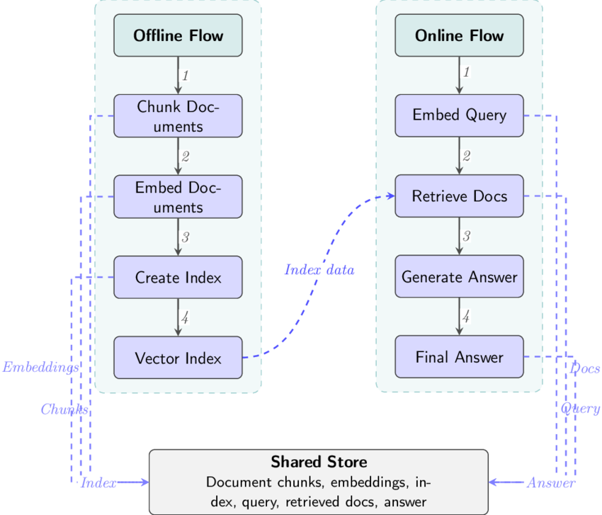

#### 1. Where would you rate yourself on (LLM, Deep Learning, AI, ML). A, B, C [A = can code independently; B = can code under supervision; C = have little or no understanding]

- **Traditional ML:** A  - I've built, and practiced to write code without supervision

- **Deep Learning:** A - I've trained/fine-tuned CNNs and Vision Transformers in PyTorch, and more often than not fix bugs, write relavent functions on my own(whenever it is efficient). [DeiT-Tiny vs MobileViT-XXS ](https://github.com/vm7151810/DeiT-Tiny-vs-MobileViT-XXS), [Plant Disease Classification](https://github.com/vm7151810/Plant-Disease-Classification)

- **LLM:** B - I've built a small RAG prototype with LangChain and a vector store by myself as projects but never built anything to scale solving real problems. [Credit risk scoring pipeline with RAG-based policy guidance](https://github.com/vm7151810/Credit-Risk-Decision)

- **AI:** B - [Route-Planner](https://github.com/vm7151810/Route-Planner)

---

#### 2. What are the key architectural components to create a chatbot based on LLM? Please explain the approach on a high-level

##### Limitations of LLM based chatbots:

1. Static knowledge - Only have knowledge of their training data
2. No access to private data
3. Hallucination - Confident but false statements

##### Two Flows:

1. **Offline flow (ingestion)**:  
   `Sources → parsing/cleaning → chunking → embedding → index in vector store (with metadata)`

2. **Online flow (query)**:  
   `User → API/auth → guardrails (input) → query understanding → retrieval → context assembly → LLM → guardrails (output) → response`

  

##### Architectural components:

1. **Interface and API gateway**: Chat interface, and a backend gateway for authenticating, handling sessions and streaming responses from LLMs

2. **Orchestration layer**: Rewrite the query using memory(adding context), retrieve from vector DB, build the prompt, call the model, model call tools, post-process the response(guardrailes). A reasonable approach is to prototype with an existing framework(LangChain, LlamaIndex, Haystack).

3. **LLMs**: The model can be a hosted API or a self-hosted open-weights model. A hosted API gives the strongest quality and least operational work, but data leaves our boundary and cost grows with usage. A self-hosted model gives full data control and predictable cost at steady high volume, but needs GPUs and serving expertise. For a security product, data control often favors self-hosting

4. **Prompt**: Prompt consists of a system prompt (role, rules, tone, behavior, citation requirement), retrieved chunks, conversation context, and the user query.

5. **Knowledge retrieval (RAG)**: Retrieve correct knowledge at query time, allows citations, and doesn't require re-training when documents change
   
   - Parsing: Preserve structure like headings, tables, facts and exact numbers.
   - Chunking: Documents are split into pieces that fit the embedding model and give precise retrieval. Too large and relevance is diluted. Too small and meaning is lost.
   - Embedding: A model turns each chunk into a vector. The choice is a trade-off between retrieval quality on our domain, dimensionality (higher means more storage and slower search), language coverage, and hosting
   - Meta-data: source, section, product, version, date, and access permissions
   - Vector Store: Stores chunk embeddings plus metadata and returns the nearest chunks for a query embedding(details in Q3).
   - Hybrid search: Combine semantic (vector) and keyword (BM25) retrieval, then merge with with Reciprocal Rank Fusion(RRF). The reason is that each method has blind spots. Vector search handles paraphrases and meaning but can miss exact tokens like error codes, product names, or CVE IDs, while keyword search is the reverse.
   - Reranking: First-stage retrieval is fast but coarse, so it fetches a wider candidate set. A re-ranker, typically a cross-encoder, then scores each query-chunk pair together and keeps only the best few for the prompt
   - Knowledge graphs: A knowledge graph stores entities and the relationships between them, instead of flat text chunks. Graph-based RAG variants retrieve relevant subgraphs and pass them to the LLM as context. The trade-off is the cost and difficulty of building and maintaining the graph (entity extraction, schema design).

6. **Security**:
   
   - Prompt injection: Treat retrieved text as untrusted data, never as instructions.
   - Data leakage and access control: Enforce each user's permissions at retrieval time (metadata filters), not after generation
   - Secrets and PII: Mitigations are to detect and redact sensitive data on both input and output, keep secrets out of prompts and in a secret manager, and avoid logging raw content

7. **Evaluation**: 
   
   - Retrieval: recall@k, precision, and MRR on a labeled question set
   - Generation: faithfulness (grounded in the retrieved text), answer relevance, and correctness, using human review and, carefully, an LLM judge

8. **Deployment**: 
   
   - Latency: streaming, caching, parallelizing independent steps, and right-sizing models.
   - Cost: token budgets, routing to cheaper models, prompt trimming, and batching.
   - Reliability: timeouts, retries with backoff, fallbacks when the model or vector store is down, and rate-limit handling.
   - Scaling: stateless services, and auto-scaling
   - Governance: audit logs, data retention, and model/prompt version tracking

---

#### 3. Please explain vector databases. If you were to select a vector database for a hypothetical problem (you may define the problem) which one will you choose, and why?

An embedding model maps content to a list of numbers, a vector, typically a few thousand dimensions. The model is trained so that items with similar meaning end up close together in this space.

Vector database stores vectors alongside their metadata and answers one core question fast: **"given this query vector, which stored vectors are the most relevant?"** 

Each chunk has an ID, a fixed-length vector, and a metadata payload. Raw vectors sit in contiguous arrays, and similarity is encoded in a separate index: HNSW stores each vector’s neighbor links in a layered graph, and IVF keeps cluster membership lists.

**Note:**

- The vector database should store embeddings plus enough metadata for filtering and retrieval

- Plan for **re-embedding** (a new embedding model means rebuilding the index) by versioning collections and doing blue/green index swaps instead of in-place changes.

##### Similarity measures:

- **Cosine similarity:** compares direction, ignoring magnitude. Common for text.
- **Dot product:** like cosine if vectors are normalized, and fast.
- **Euclidean (L2) distance:** straight-line distance.

##### Approximate nearest neighbor (ANN):

Exact nearest-neighbor search compares the query with every stored vector, which costs $O(N \cdot d)$ per query and is too slow for millions of vectors

The key idea is to trade a little accuracy for a lot of speed. Instead of guaranteeing the exact top-k, an ANN index returns results that are *almost always* the true nearest neighbors, in sub-linear time. The quality is measured by **recall@k** (what fraction of the true top-k you returned).

- **HNSW** (Hierarchical Navigable Small World; Malkov & Yashunin): Multi-layer proximity graph; search greedily from a sparse top layer down to a dense bottom layer
- **IVF** (inverted file): Cluster vectors; search only the nearest clusters

##### The hypothetical problem:

**A documentation assistant for a cloud-native security product company:** An internal and customer-facing chatbot answers questions from product documentation, release notes, runbooks, and security advisories.

- **Corpus:** about 2 million chunks now, growing to about 10 million, embedded with a 1024-dimension model.
- **Query pattern:** about 50 queries per second at peak; target under 200 ms for retrieval. Every query is filtered by product, version, and customer tier, and users may only retrieve content they are permitted to see
- **Search needs:** hybrid retrieval, because users search for exact identifiers as well as natural-language questions.
- **Data dynamics:** docs change daily; old versions must be deleted or superseded without downtime.
- **Constraints:** must **self-host** inside the company's cloud account

##### The choice: Qdrant

1. **Filtering is central, and Qdrant is built around it:** Every query is filtered by product, version, and tier. Qdrant applies filters during graph traversal using payload indexes, which keeps recall and latency stable even with selective filters (where naive post-filtering would return too few results).
2. **Hybrid search without a second system:** Dense and sparse vectors can be queried together and fused, so exact identifiers like CVE IDs and error codes are retrievable without bolting on a separate search engine.
3. **Scale:** 2M-10M vectors is comfortably in range, and scalar quantization keeps memory modest. Distributed mode exists if growth exceeds a single node.
4. **Operational simplicity:** A single service (Rust-based, container-friendly) that a small team can run, snapshot, and upgrade, with no multi-component cluster to manage.
5. **Self-hosted and open source:** Satisfying compliance, with no vendor lock-in on the data plane.
6. **Access control by design:** tier and permission attributes stored as payload and enforced as a **mandatory filter** applied server-side in the retrieval layer, so internal-only content can't be returned to unauthorized users.

##### Trade-offs

- **A second data store.** Qdrant would sit beside the primary document store, so a sync process would be needed.
- **Hybrid search maturity** may be less feature-rich than a dedicated search engine's, such as advanced analyzers and language-specific tokenization.

##### Other options:

- **pgvector:** If the corpus stayed under about a million vectors, the team already ran Postgres, filters were simple, and joining vectors with relational data were important.
- **Milvus** would've been the choice at 100M+ vectors with a dedicated platform team.
- **Elasticsearch/OpenSearch** would be the choice if company already ran it and keyword search was the dominant mode, with vector search as a supplement.

---