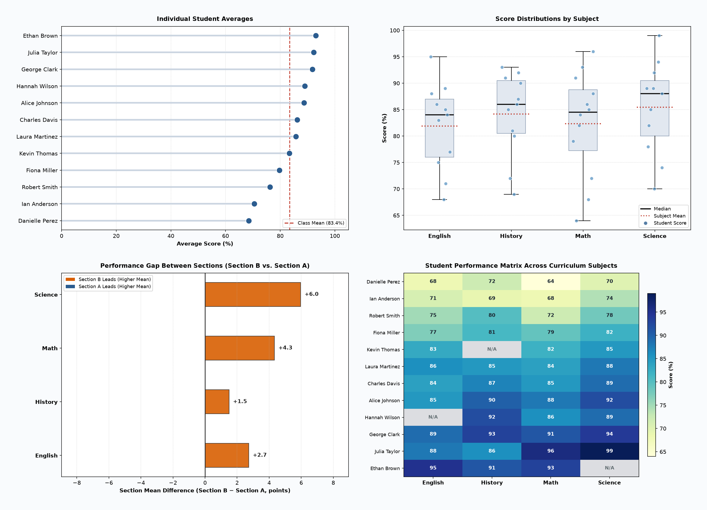

# Accuknox Recruitment Assessment

This repo contains implementations for the Accuknox technical assessment tasks:

##### Assignment 1

1. **API Data Retrieval and Storage ETL Pipeline (`books_etl.py`)**: You are tasked with fetching data from an external REST API, storing it in a local SQLite database, and displaying the retrieved data. The API provides a list of books in JSON format with attributes like title, author, and publication year.

2. **Student Test Scores Processing & Analytics Visualization (`student_scores.py`)**: Given a dataset containing information about students' test scores, fetch the data from an API, calculate the average score, and create a bar chart to visualize the data.

3. **CSV Data Import to SQLite Database (`import_users.py`)**: Write a Python script that reads data from a CSV file containing user information (e.g., name, email) and inserts it into a SQLite database.

4. Send a link to the most complex Python code you have written 

5. Send a link to the most complex database code you have written

## Task 1: API Data Retrieval and Storage ETL Pipeline

A lightweight Python 3 ETL pipeline that fetches book data from the Open Library REST API, cleans and normalizes the data, stores records in a local SQLite database, and displays them in a formatted table.

### Features

- **Extract**: Queries the [Open Library Search API](https://openlibrary.org/search.json) for specific fields (`key`, `title`, `author_name`, `first_publish_year`) with timeouts and strict exception handling. Network and decoding failures raise `APIFetchError`, allowing the pipeline to fail fast and abort with exit code `1` rather than reporting false empty successes.
- **Transform**: Validates mandatory fields (`key`, `title`), normalizes author lists into a clean comma-separated string, and coerces publication years into integers.
- **Load**: Ensures the SQLite connection is reliably closed, and wraps insertions in an atomic transaction using parameterized queries and `INSERT OR IGNORE` on the unique work key. Running the script repeatedly produces zero duplicates.
- **Display**: Formats and prints stored books in an ASCII table with column width truncation.
- **Logging**: Configured via the standard `logging` module with structured timestamps, levels, warning logs for skipped invalid records, and an execution summary log.

### Schema

```sql
CREATE TABLE IF NOT EXISTS books (
    id INTEGER PRIMARY KEY AUTOINCREMENT,
    ol_key TEXT NOT NULL UNIQUE,
    title TEXT NOT NULL,
    author TEXT,                      -- Joined comma-separated author names, or NULL
    publication_year INTEGER          -- First publication year, or NULL
);
```

### Usage (Task 1)

```bash
python3 books_etl.py
# Custom search query, limit, and database file
python3 books_etl.py --query "distributed systems" --limit 5 --db my_books.db
```

---

## Task 2: Student Test Scores Processing & Visualization

Fetches student scores over HTTP (or from a local JSON file), cleans them per value, computes statistics, and saves charts as PNG files.

### Approach

- **Mock API (`mock_api.py`)**: Standard-library HTTP server serving `students_data.json` at `/api/scores`. No API was specified, so this stands in for one; `--url` accepts any endpoint with the same JSON shape.

- **Fetch**: `--url` or `--file` (local fallback). Network, HTTP, and JSON errors raise `ScoreDataFetchError` and exit with code `1`.

- **Per-value cleaning**: A bad score never discards the whole student; each value is checked on its own.
  
  | Input                                                           | Action            | Log level |
  | --------------------------------------------------------------- | ----------------- | --------- |
  | Numeric string (`"85"`)                                         | Coerced to `85.0` | INFO      |
  | Out of range (`142`), `null`, non-numeric (`"absent"`), boolean | Dropped           | WARNING   |
  
  Averages use each student's remaining valid subjects, and every fix is listed in an audit trail printed at the end.

- **Statistics (`compute_statistics`)**: Student averages and ranks, class benchmark, per-subject and per-section metrics. It is separate from plotting, so it can be tested without drawing anything.

- **Charts**: Matplotlib with the headless `Agg` backend. Bar-style charts start at 0 to avoid exaggerating differences.

### Assumptions

1. Scores are percentages from 0 to 100; anything outside is treated as an error.
2. The class benchmark is the mean of all valid scores (83.4% for the sample data).
3. The sample has 12 students in 2 sections and 4 subjects, with one anomaly of each type above (except booleans).

### Charts



| Chart                                    | File                                 | Question it answers                                                                                |
| ---------------------------------------- | ------------------------------------ | -------------------------------------------------------------------------------------------------- |
| Student averages (lollipop)              | `chart1_student_averages.png`        | How does each student compare with the class benchmark? Students marked `*` have partial averages. |
| Subject distribution (box plot + points) | `chart2_subject_distribution.png`    | Which subjects are hardest, and how widely do scores spread?                                       |
| Section gap (diverging bars)             | `chart3_section_subject_gap.png`     | Where, and by how much, does Section B differ from Section A?                                      |
| Student × subject heatmap                | `chart4_student_subject_heatmap.png` | Where is each student strong or weak? Missing values show as `N/A`.                                |

### Usage

```bash
# Option A: through the mock API (two terminals)
python3 mock_api.py --port 8000
python3 student_scores.py --url http://127.0.0.1:8000/api/scores

# Option B: local file, no server
python3 student_scores.py --file students_data.json
```

Other options: `--output` (dashboard path), `--output-dir` (individual charts), `--timeout`, `--show` (display a window).

---

## Task 3: CSV Data Import to SQLite Database

Reads user records (`name`, `email`) from a CSV file, validates and normalizes each row, and loads valid rows into SQLite idempotently.

### Features

- **Pre-validation**: The file and header are checked before the database is opened, so a bad input exits with code `1` and never leaves an empty `.db` file behind.
- **Tolerant input**: Headers match case-insensitively with extra columns allowed; `utf-8-sig` handles Excel's BOM.
- **Row-level cleaning**: Names and emails are trimmed and emails lowercased. Invalid rows (empty name, malformed email) are skipped and logged by row number and reason, without logging the personal data itself.
- **Idempotent, atomic load**: One transaction using `INSERT OR IGNORE` on the unique email, so re-runs add nothing, and a mid-file read error rolls everything back.
- **Exact accounting**: The summary reports `read`, `inserted`, `duplicates`, and `invalid`, and the program checks that `read = inserted + duplicates + invalid`.
- **Round-trip display**: The stored users are printed from the database at the end.

### Schema

```sql
CREATE TABLE IF NOT EXISTS users (
    id INTEGER PRIMARY KEY AUTOINCREMENT,
    name TEXT NOT NULL CHECK (length(trim(name)) > 0),
    email TEXT NOT NULL UNIQUE COLLATE NOCASE   -- one account per address
);
```

The `CHECK` and `COLLATE NOCASE` constraints repeat the Python validation inside the database, as a second line of defense.

### Design choices

| Choice                                           | Why                                                                                                                                               |
| ------------------------------------------------ | ------------------------------------------------------------------------------------------------------------------------------------------------- |
| Single transaction, not a commit per row         | One disk sync instead of N, and an all-or-nothing import                                                                                          |
| `INSERT OR IGNORE` + `rowcount`                  | Counts duplicates without using exceptions for control flow. The trade-off is that existing rows are never updated; an upsert would refresh them. |
| Deduplicate in the database, not in a Python set | Constant memory for any file size. The trade-off is that logs can't tell in-file duplicates from existing ones.                                   |
| Simple email regex (`user@domain.tld`)           | Catches obvious errors; full RFC validation is out of scope                                                                                       |

Blank lines are not counted as rows, since `csv.DictReader` skips them.

### Sample data (`users.csv`)

Valid rows (Alice, Bob, Grace), a duplicate (`Bob Jones, BOB.JONES@EXAMPLE.COM`, caught only through normalization), a missing name, and an invalid email.

### Usage

```bash
python3 import_users.py
python3 import_users.py --csv custom_users.csv --db custom.db
```

---

## Task 4 & 5

- Send a link to the most complex Python code you have written: [Plant Disease Classification](https://github.com/vm7151810/Plant-Disease-Classification).

- Send a link to the most complex database code you have written: [Credit risk scoring pipeline with RAG-based policy guidance](https://github.com/vm7151810/Credit-Risk-Decision). The most complex database work was at Tryb, using where I used Firebase Realtime Database.
